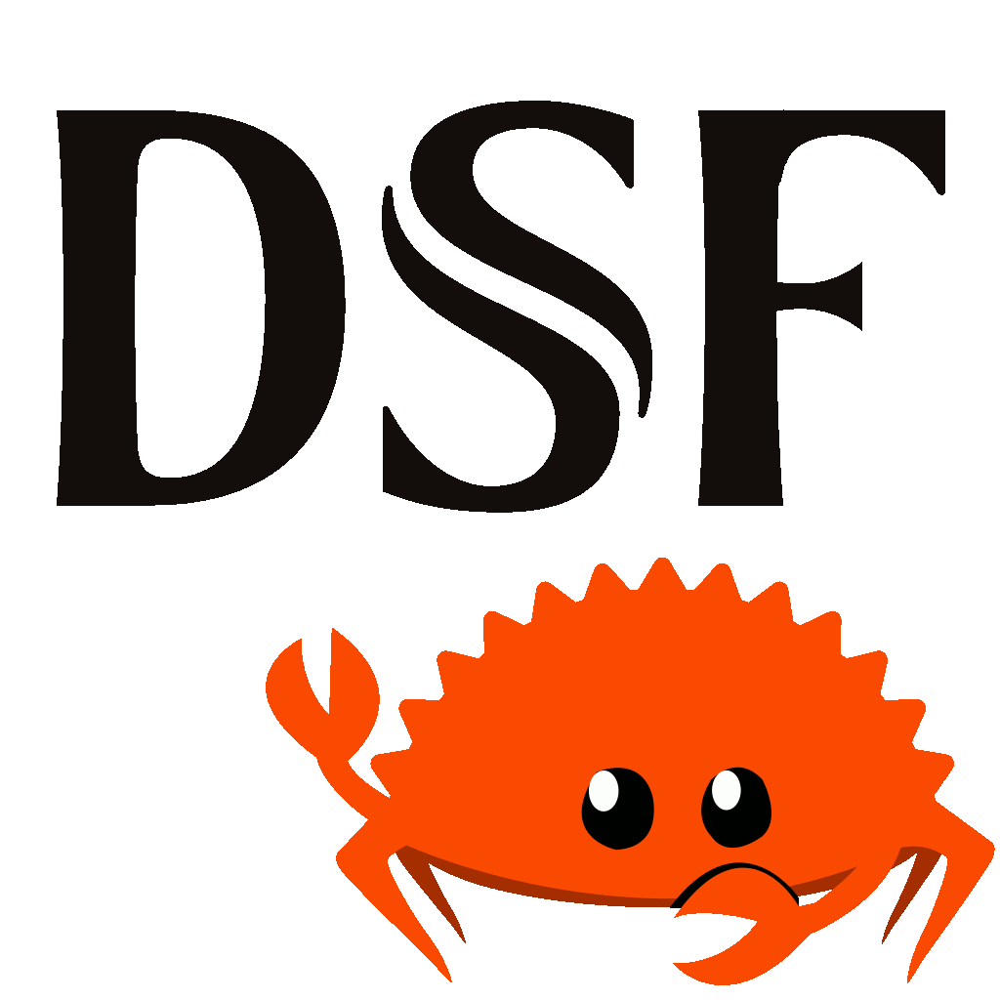

<!-- markdownlint-disable MD033 -->
#  DSD Stream File #

DSF (DSD Stream File) support in Rust. DSF files are a high-resolution
audio format that contain lossless 1-bit audio stream in delta sigma
modulation aka Direct Stream Digital (DSD). The format is intended for
1-bit DSD DACs.

This package is a mostly compatible fork of the dsf crate by Daniel J. R. May, but it focuses on reading metadata and leaves it up to the implementor to iterate over the dsd samples using the info from that metadata, such as the audio offset and number of samples. It also allows for incomplete ID3 tag reads without causing a failure to instantiate the DsfFile object.

For a crate that makes use of this library and does provide access to the audio data, see [`dsd-reader`](https://crates.io/crates/dsd-reader).

## Examples

```rust
use dsf_meta::DsfFile;
use std::path::Path;

let path = Path::new("my/music.dsf");

match DsfFile::open(path) {
    Ok(dsf_file) => {
        eprintln!("DSF file metadata:\n\n{}", dsf_file);
    }
    Err(error) => {
        eprintln!("Error: {}", error);
    }
}
```

```rust
use dsf_meta::DsfFile;
use std::path::Path;

let path = Path::new("my/music.dsf");

let dsf_file = DsfFile::open(path).unwrap();
if let Some(e) = dsf_file.tag_read_err() {
    eprintln!("[Warning] Full read of ID3 tag failed. Partial read attempted: {}", e);
}
```

## References ##

* [DSF file format
specification](https://dsd-guide.com/sites/default/files/white-papers/DSFFileFormatSpec_E.pdf)
